  

  
  
  
  

---

### 🌱 About

- 💡 Learning something new about 💻 every day
- 🔐 Growing toward **Application Security Engineering** (web dev + server admin + security)
- 🎧 🏃 📖 In my free time: music, running, reading
- 📪 Reach out for questions, collabs, or a meme worth sharing

---

### 🛠 Daily drivers

### 🛒 CMS & E-commerce

### ☁️ Servers & DevOps

### 🔐 Security

### 🧰 Tools

### 💡 Exploring

---

### ⚙️ GitHub stats

  
  

  

  
  

---

### 🐍 Contribution snake

  <picture>
    <source media="(prefers-color-scheme: dark)" srcset="https://raw.githubusercontent.com/simbaig/simbaig/output/github-snake-dark.svg" />
    <source media="(prefers-color-scheme: light)" srcset="https://raw.githubusercontent.com/simbaig/simbaig/output/github-snake.svg" />
    
  </picture>

  

